# 1. 核心基础

## 1.1 内核与发行版

e.g.`Ubuntu` `CentOS`

`Linux`只是一个操作系统**内核**，要构建完整的操作系统需要加入大量用户空间软件，最终构建成**发行版**

不同`Linux`发行版就像不同厂商发行的安卓版。

- `Ubuntu`是最流行的系统，不同版本差异不大。

## 1.2 Shell和命令

用户输入的Shell（命令解释器）负责解析，` Ubuntu`中默认是 `bash`.

`bash`在等待用户输入命令时，会出现命令提示符，同时展现当前用户名、该计算机的名称、当前工作命令。输入完成后按下回车键，`Shell`就会开始执行命令。


- `echo`：将后面的内容输出到终端，可以理解为“复读”。
  - 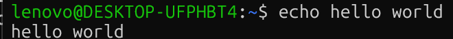
- `sleep`：等待X秒
  - 
- `Ctrl+C`：中断当前命令

命令的基本结构：

```linux
name[parameters]
```

`name`：命令名称，大小写敏感。

`parameters`：命令参数，控制具体调用行为与提供数据，可以有多个

### 典型的命令参数语法

| 类型           | 作用                   | 语法结构              | 示例          |
| :------------- | :--------------------- | :-------------------- | :------------ |
| 不带值的短参数 | 一般作为开关使用       | `-[参数名]`           | `-a`          |
| 带值的短参数   | 用来传递具体的参数值   | `-[参数名] [参数值]`  | `-n 10`       |
| 不带值的长参数 | 一般作为开关使用       | `--[参数名]`          | `--all`       |
| 带值的长参数   | 用来传递具体的参数值   | `--[参数名]=[参数值]` | `--size=10MB` |
| 位置参数       | 用于传递具体的操作对象 | `[操作对象] ...`      | `sample.txt`  |

e.g.

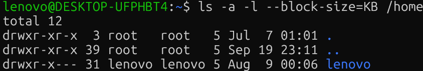

一些语法的变体：

| 类型               | 特点                                 | 语法结构               | 示例            |
| :----------------- | :----------------------------------- | :--------------------- | :-------------- |
| 合并的多个短参数   | 多个短参数合到一起写                 | `-[参数名][参数名]...` | `-a1h`          |
| 不隔开的带值短参数 | 完全不隔开短参数和值                 | `-[参数名][参数值]`    | `-j16`          |
| 不用=的带值长参数  | 不用等号隔开参数和值，而是用空格隔开 | `--[参数名] [参数值]`  | `--size` `10MB` |

### 高效键入命令

1. 历史记录：`↑` `↓`
2. `TAB`补全：按两下`TAB`可以列出候选项


3. 光标导航：
   1. `home`：移动到命令头
   2. `End`：移动到命令尾
   3. `Ctrl+←/→`：移动一个单词
4. 复制粘贴：与UI界面略有差异
   - `Ctrl`+`Insert`：复制选中文字
   - `Shift`+`Insert`：粘贴文字
5. 清屏：`clear` or `Ctrl+L`
6. 获取命令的文档：`--help`
   - e.g.`ls --help`
   - `man [command]`获取命令的帮助文档

## 1.3 目录、文件和路径

### 1. Linux目录结构

| 特性       | Linux                                               | Windows                                   |
| :--------- | :-------------------------------------------------- | :---------------------------------------- |
| 目录分隔符 | 正斜杠 `/`                                          | 反斜杠 `\`                                |
| 根目录     | 目录树仅有一个根节点 `/`                            | 每个盘符都有独立的根目录，如 `C:\`、`D:\` |
| 大小写敏感 | 通常区分大小写，`File.txt` 和 `file.txt` 是两个文件 | 默认不区分大小写，二者通常视为同一文件    |

e.g.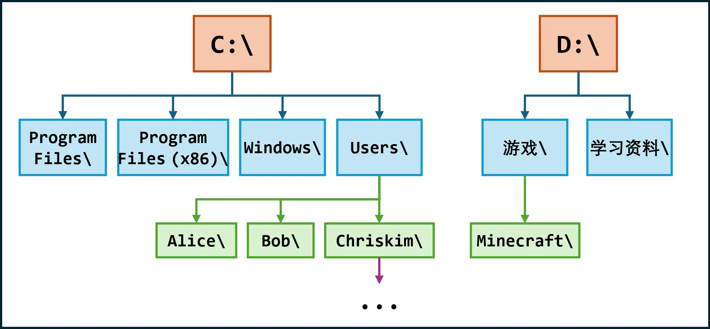

用户的家目录在`/home/用户名`下，打开默认在这里

### 2. 路径的写法

1. 绝对路径

   从根目录开始，一级一级写到目标开头，绝对路径必须以`/`开头

2. 相对路径

   用`..`代表工作目录的上一层，用`.`代表当前工作目录；相对路径**不能以`/`开头**

   ```linux
   # 如果当前工作目录为 /home/chriskim/，那么以下相对路径：
   movies/
   movies/interstellar.mp4
   ../
   ../../data/llm/weights/Qwen3.6-35B-A3B/config.json
   ././././././././././././././
   # 他们分别代指的绝对路径是：
   /home/chriskim/movies/
   /home/chriskim/movies/interstellar.mp4
   /home/
   /data/llm/weights/Qwen3.6-35B-A3B/config.json
   /home/chriskim/
   ```

3. 家目录：用`~`来快捷指定

### 3. 切换与查看目录

核心命令是`cd` `ls` `pwd`

#### `cd`：change directory

- 用途：切换当前的工作目录
- 参数：位置参数：想切换的目标目录，若无则传回`home`
- `cd -`：回到上一次执行`cd`所在的目录

#### `ls`：list

- 用途：打印指定目录的内容

- 核心参数：

  - 位置参数：想打印的目标目录，不传则打印当前工作目录
  - `-a`：打印隐藏内容
  - `-l`：以详细列表形式打印
  - `-F`：在文件名后显示类别指示符
  - `-h`：以更直观的方式显示文件大小

  > Linux中以`.`开头的文件或目录叫隐藏文件或目录，如`.cache` `.config` `.gitignore`等

  1. `ll` == `ls -alF`

  

  具体含义：

  ```
  drwxr-xr-x  2 user user 4096 Aug  2 21:20 Documents/
  │           │ │    │    │    │            └─ 文件名
  │           │ │    │    │    └─ 最后修改时间
  │           │ │    │    └─ 文件大小，单位通常是字节
  │           │ │    └─ 所属组
  │           │ └─ 所有者
  │           └─ 硬链接数量
  └─ 文件类型和权限
  ```

  `-F`参数：会在文件名后显示类别指示符，如：

  - 没有指示符：普通文件
  - `*`：可执行文件
  - `/`：目录
  - `@`：符号链接
  - `|`：命名管道
  - `=`：套接字

2. `l` == `ls -CF`

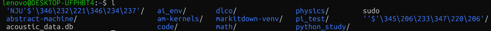

不会打印隐藏文件和详细列表。

3. `ll -h` == `ls -alFh`，相比示例1带上了`K/M`等单位

   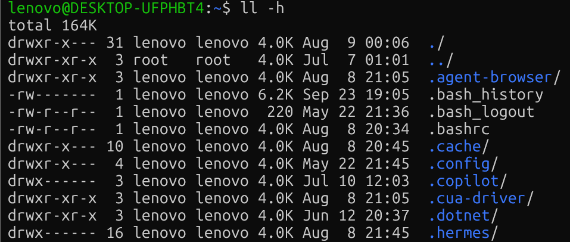

4. 指定位置参数

   不指定位置时，`ls`会打印当前路径下的内容，若指定则打印给定路径的内容

   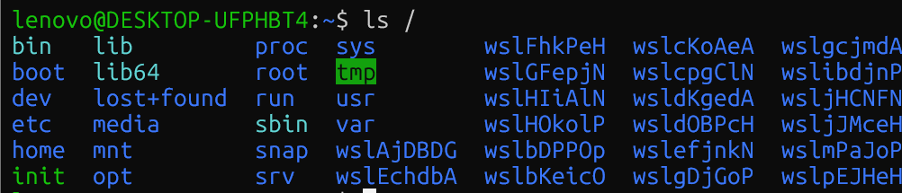

   ​

#### `pwd` : print working directory

打印当前工作目录，无需任何参数。

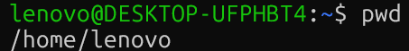

### 4. 查看和运行文件

#### `cat`：concatenate 查看文件

核心参数：

- 位置参数：想要查看文件的路径；若传多个则依次连接并输出
- 不要使用`cat`打开超大的文件，否则会把终端卡住；
- 也不要用`cat`打开二进制、图片等非纯文本，只会输出一大堆乱码

#### 运行文件

如果有些文件为可执行程序或脚本文件且有执行权限，可以通过Shell调用运行

### 新建目录和文件

#### `mkdir`：make directory

- 用途：新建目录
- 核心参数：
  - 位置参数：想要新建目录的路径，可以传多个
  - `-p`：父目录不存在时一并创建，可一次性**新建多级目录**

e.g.

```
# 若当前工作目录为 /home/chriskim
mkdir test       # 新建 /home/chriskim/test/
mkdir /data/docs # 新建 /data/docs/，前提是/data已经存在且可写
mkdir a b c      # 新建 /home/chriskim/a/, /home/chriskim/b/,   /home/chriskim/c/
mkdir x/y/z      # 报错 No such file or directory
mkdir -p x/y/z   # 新建 /home/chriskim/x/, /home/chriskim/x/y/, /home/chriskim/x/y/z/
```

#### `touch`

- 用途：新建空文件
- 核心参数：
  - 位置参数：新建文件的路径，可以传多个，一次性新建多个文件

e.g.

```
# 若当前工作目录为 /home/chriskim
touch test.txt   # 新建 /home/chriskim/test.txt
touch a b c      # 新建 /home/chriskim/a, /home/chriskim/b, /home/chriskim/c
```

### `find`：查找文件和目录

```
find[起始目录][查找条件]
```

查找条件如下：

- `-name 名称`：按照名称查找，**区分大小写**
- `-iname 名称`：按照名称查找，**不区分大小写**
- `-type f`：只查找不同文件
- `-type d`：只查找目录
- `maxdepth n`：最多向下查找n层目录

起始目录的一些表示：

- `.`：当前目录及子目录
- `~`：家目录及子目录
- `/data`：具体路径

> 关于通配符`*`：任意一段字符，如`"*.txt"`可以匹配所有以`.txt`结尾的名称
>
> - 尽量将名字用引号包起来而不是提前展开

e.g.

```
# 在当前目录及其子目录中查找 config.json
find . -name "config.json"
# 在家目录及其子目录中查找所有 .txt 文件
find ~ -name "*.txt"
# 不区分大小写查找所有名称以 readme 开头的对象
find . -iname "readme*"
# 在 /data 中只查找名为 checkpoints 的目录
find /data -type d -name "checkpoints"
# 在 /data 中只查找 .pt 文件
find /data -type f -name "*.pt"
# 只查找当前目录及其下一层，不再继续深入
find . -maxdepth 1 -name "*.txt"
```

## 1.4 复制、移动和重命名

### `cp`：copy

- 用途：复制对象
- 核心参数：
  - 位置参数1：原对象路径
  - 位置参数2：目标路径
  - `-r`：是否递归复制（对文件夹使用，不加只复制文件夹本身，加上可以复制文件夹里的内容

`cp`命令的行为与目标对象是否存在有关。

1. 若已存在：

- 文件 to 目录：将文件复制到目录里面
  - 若已存在同名对象，则会覆盖
- 目录 to 目录：将目录复制到目录里面
  - 若已存在同名目录，则将二者内容合并
- 文件 to 文件：将文件覆盖目标文件（**不可恢复**）
- 目录 to 文件：报错

2. 若目标对象存在，但目标对象的上一层目录存在：

   `cp`会根据目标路径创建一个新的副本，但不会根据扩展名判断对象类型。e.g.

   ```
   # 如果目标对象不存在（但上一层目录存在）
   cp file.txt /data/new.txt      # 将 file.txt 复制为 /data/new.txt
   cp file.txt /data/new_dir      # 将 file.txt 复制为名为 new_dir 的文件（cp 不会根据扩展名判断对象类型）
   cp -r dir /data/new_dir        # 将 dir/ 复制为 /data/new_dir/ 目录
   cp -r dir /data/new.txt        # 将 dir/ 复制为 /data/new.txt/ 目录（cp 不会根据扩展名判断对象类型）
   ```

3. 若上一层目标不存在，则`cp`直接报错

### 移动和重命名

#### `mv`：move

- 用途：移动对象；重命名也可以理解为一种移动

- 核心参数：

  - 位置参数1：源对象路径
  - 位置参数2：目标路径

- 同理，`mv`的行为主要与目标对象是否存在是否有关。

  1. 若目标对象已存在：

  ```
  # 如果目标对象路径存在（/data 目录和 exist.txt 文件都存在）
  mv file.txt /data         # 将 file.txt 移动为 /data/file.txt
  mv dir /data              # 将 dir/ 目录移动为 /data/dir/
  mv file.txt exist.txt     # 用 file.txt 覆盖 exist.txt
  mv dir exist.txt          # 报错！不能用目录替换普通文件
  ```

  > 若已存在同名对象，则会对象类型的影响
  >
  > ```
  > mv file.txt /data         # 如果 /data/file.txt 已存在，则覆盖它
  > mv dir /data              # 如果 /data/dir 已存在并非空，则报错；如果它为空，则被源目录替换
  > ```

  2. 若目标对象不存在但上一层目录存在，`mv`会让原对象变为指定目标路径。

  ```
  # 如果目标对象不存在（但上一层目录存在）
  mv file.txt /data/new.txt    # 将 file.txt 移动并重命名为 /data/new.txt
  mv file.txt /data/new_dir    # 将 file.txt 移动为名为 new_dir 的文件（mv 不会根据扩展名判断对象类型）
  mv dir /data/new_dir         # 将 dir/ 移动并重命名为 /data/new_dir/
  mv dir /data/new.txt         # 将 dir/ 移动为名为 new.txt 的目录（mv 不会根据扩展名判断对象类型）
  ```

  3. 若上一层目录不存在，`mv`会直接报错。


## 1.5 删除对象

### `rm`：remove

**需要十分谨慎，不存在“回收站”机制；删除后，对象已经从磁盘中消失了！！！**

- 用途：删除对象（文件或目录）

- 核心参数：

  - 位置参数：想删除对象的路径，可传多个

  - `-i`：每次删除前询问用户

  - `-I`：在较危险情况下询问用户（递归删除目录/一次删除超过三个操作对象时，执行前统一询问）

  - `-f`：强制删除，操作对象不存在时不报错

  - `-d`：删除空目录

    - 与`rmdir`：remove directory用途相同
    - 非空目录会报错

  - `-r`：递归删除目录

    ```Linux
    rm -r test_dir  # 将 test_dir 以及里面所有内容删除，不可恢复
    rm -ri test_dir # 将 test_dir 以及里面所有内容删除，不可恢复，但在每次删除前 rm 都会再次询问用户
    rm -rI test_dir # 只会在 rm 觉得比较危险时才会发出提示
    rm -rf test_dir # 确保无误，不询问用户强制删除这个目录
    ```

    

### 安全性

1. 不要手滑多打空格

   - 假如执行的命令是：`rm -rf /home/chriskim/test_dir`
   - 不要打成了：`rm -rf /home/chriskim /test_dir`

   如果变成这样，相当于传递了两个参数；命令就变成了递归删除 `/home/chriskim` 和 `/test_dir`。尽管第二个路径 `/test_dir` 不存在，但是第一个路径 `/home/chriskim` 是存在的，`rm` 命令会非常听你的话，**将整个家目录删除干净，什么都不会留下**。

   - 更不要手滑打成了：`rm -rf / home/chriskim/test_dir`

   如果打成这样，从理论上来说，`rm -rf /` 会把整个系统里能删的东西**全部删了**！但是 `rm` 对根路径进行了特判，删除根路径时会报错“rm: it is dangerous to operate recursively on '/'”并停止。

2. 千万不要打错绝对路径

   - 假如执行的命令是：`rm -rf data`
   - 不要打成了：`rm -rf /data`

   第一个命令删除的是当前工作目录下的 `data` 目录。而第二个命令删除的是系统根目录下的 `/data` 目录，删掉这个可能就把整个服务器存的所有数据集**全部删除**了！

3. 与通配符、变量或脚本搭配


## 1.6 查看和编辑

### 分页查看文本：`more` 和 `less`

大多数情况下选`less`就可以

1. `more`

- 用途：分页查看文件
- 参数：
  - 位置参数：想看的文件的路径
  - `+行号`：从指定行开始显示
  - `+/字符串`：从第一次匹配的位置开始显示
- 快捷键：
  - `Space`：下一屏
  - `Enter`：下一行
  - `q`：退出
- e.g.

```
more access.log         # 分页查看 access.log
more +100 access.log    # 从 100 行开始分页查看 access.log
more +/error access.log # 从第一次匹配 error 的位置开始显示
```

2. `less`

- 用途：更强的分页查看文件
- 核心参数：
  - 位置参数：想看的文件的路径
  - `+行号`：从指定行开始显示
  - `+/字符串`：第一次匹配的位置开始显示
  - `-N`：显示行号
  - `-S`：长行不断行，可左右滚动
- 快捷键：
  - `Space`：下一屏
  - `↓` 或 `Enter`：下一行
  - `↑`：上一行
  - `←`：向左滚动长行，通常配合 `-S` 使用
  - `→`：向右滚动长行，通常配合 `-S` 使用
  - `q`：退出

### 查看文本头尾：`head`和`tail`

1. `head`

- 用途：查看文件头部
- 核心参数：
  - 位置参数：想看的文件的路径
  - `-n 行数`：显示头部指定行数，默认10行

2. `tail`

- 用途：查看文件尾部
- 核心参数：
  - 位置参数
  - `-n 行数`
  - `-f`：持续跟踪文件尾部，若有增多则打印


### 文本编辑器：`vim`和`nano`

#### `vim`：上手难度极高的编辑器

1. 打开文件

使用`vim [path]`打开想要编辑的文件

2. 编辑文件

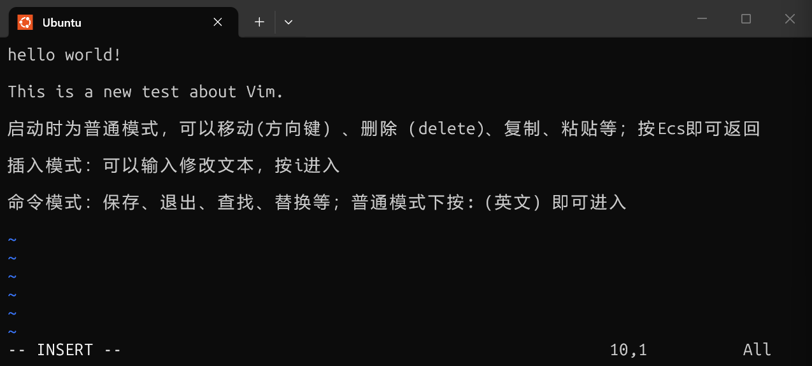

与保存文件相关的命令如下：

- `:w`：保存不退出
- `:wq`：保存并退出
- `:q`：退出，文件有未保存修改时会拒绝
- `:q!`：强制退出，文件有未保存修改时丢弃

3. 其他常见功能

普通模式时输入`/`来进行搜索

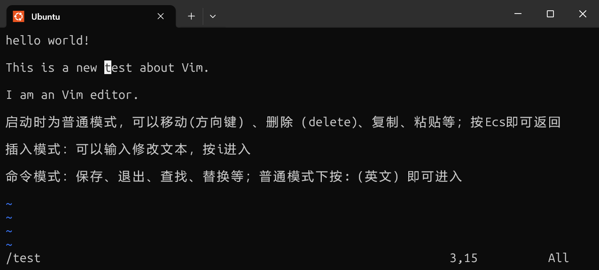

- `:set number`/`set nonu`：开启/关闭行号显示
- `:行号`：跳转到指定行号

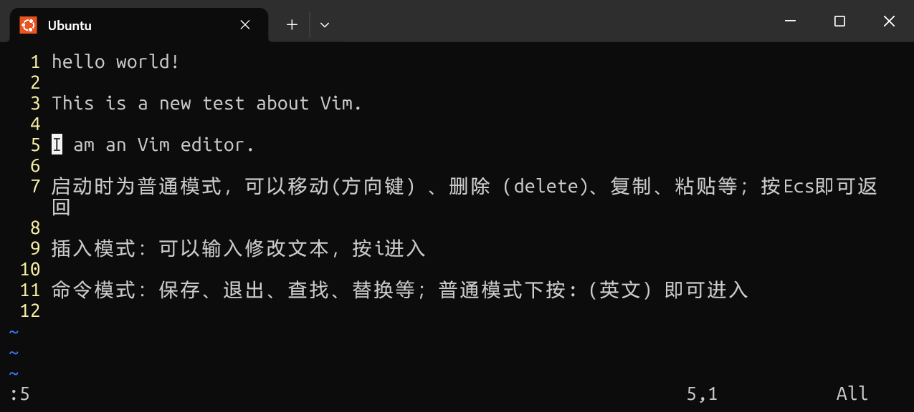

#### `nano`编辑器

操作更简单，底部会显示常用功能的快捷键；其中，`^`表示`Ctrl`键。


## 1.7 特殊符号

### 通配符

- `*`：匹配**任意数量（包括0）**的任意字符
- `?`：匹配任意**一个**字符
- `[...]`：匹配方括号中指定的任意**一个**字符

**1. 任意数量任意字符** 

示例匹配：

- 可以被 `*.txt`匹配的示例
  - `file.txt`、`123.txt`

- 可以被 `.*.txt` 匹配的示例

  - `.file.txt`、`.123.txt`

- 可以被 `checkpoint*.ckpt` 匹配的示例

  - `checkpoint01.ckpt`、`checkpoint_latest.ckpt`

- 可以被 `cache*` 匹配的示例

  - `cache.bin`、`cache-file.txt`

**需要注意，默认情况下如果文件名以 . 开头，匹配模式也需要显式写出开头的 .**

**2. 一个任意字符 ?**

示例匹配：

- 可以被 `?.txt` 匹配的示例

  - `1.txt`、`a.txt`

- 可以被 `img_??.png` 匹配的示例

  - `img_00.png`、`img_ab.png`

- 可以被 `archive.tar.gz.part?` 匹配的示例

  - `archive.tar.gz.part1`、`archive.tar.gz.part9`

**3. 指定的字符 [...]**

示例匹配：

- 可以被 `[ab].json` 匹配的示例

  - `a.json`、`b.json`

- 可以被 `img_[0-9].png` 匹配的示例

  - `img_5.png`、`img_9.png`

- 可以被 `[0-9a-fA-F][0-9a-fA-F]` 匹配的示例

  - `60`、`1b`、`eB`

### 重定向

用于改变命令从哪里读取输入，以及把输入发送哪里。常见的重定向符号有：

- 重定向输入：

  - `<`：从文件中读取标准输入

- 重定向输出：

  - `>`：将标准输出写入文件，原有内容会被覆盖

  - `>>`：将标准输出追加到文件末尾

  - `2>`：将标准错误写入文件，原有内容会被覆盖

  - `2>>`：将标准错误追加到文件末尾

e.g.1.将`input.txt`的内容输入`mul.py`中

```python
# mul.py：从标准输入读取两个数字，输出乘积
a = int(input())
b = int(input())
print(a * b)
```

```text
# input.txt 内容
8
9
```

使用命令

```bash
python3 mul.py < input.txt
```

就会在终端打印结果72


e.g.2将`test.py`的内容输出到文件中

Python 程序 `test.py`：

```python
print("this is a message to stdout")
assert False, "this is a message to stderr"
```

直接运行该程序后，结果在终端输出：
```text
this is a message to stdout
Traceback (most recent call last):
  File "/home/chriskim/test.py", line 2, in <module>
    assert False, "this is a message to stderr"
           ^^^^^
AssertionError: this is a message to stderr
```

将输出与错误重定向至文件：
```bash
python3 test.py > output.txt 2> error.txt
```

`output.txt` 内容：
```text
this is a message to stdout
```

`error.txt` 内容：
```text
Traceback (most recent call last):
  File "/home/chriskim/test.py", line 2, in <module>
    assert False, "this is a message to stderr"
           ^^^^^
AssertionError: this is a message to stderr
```
### 命令连接

将多个命令组合在一起执行，最常用的命令连接符号有：

- 连续执行：
  - `;`：依次执行多个命令
  - `&&`：前一个命令执行成功时，才执行后一个命令
  - `||`：前一个命令执行失败时，才执行后一个命令
- 管道符号：
  - `|`：将前一个命令的标准输出连接到后一个命令的标准输入

e.g.

- 连续执行

  ```
  # 从左到右依次执行，不管成功或者失败
  mkdir test; cd test; touch hello.txt
  # 从左到右依次执行，只有成功才继续，无论在哪失败执行链就会断开
  mkdir test && cd test && touch hello.txt
  # 前一个命令失败后才会执行后面的命令
  cd non-exist-dir || echo "无法进入目录"
  ```

- 管道符号：可以完成非常复杂的事情

  ```
  ll | head -n 50 						  # 使用 ll 列出目录并只看前 50 行
  cat access.log | head -n 50 | tail -n 25	# 查看 access.log 的第 26~50 行
  ```

  所有命令同时进行，只要上一个命令有了输入就会交给下一个命令；因此前面的命令报错不会停止后续的命令，只是收不到输入。

- 优先级：`|` > `&&` = `||` >`;`

### 变量

临时储存数据，便于数值复用。常见的有：

- `=`：为变量赋值
  - **等号两端不要随意添加空格！！**，否则会认为执行该命令
- `$name` 或 `${name}`：读取变量的值

变量名的命名规则同各种语言。

读取变量，若想连在一起可以用`${name}others`的命令。

删除变量：`unset name`

e.g.

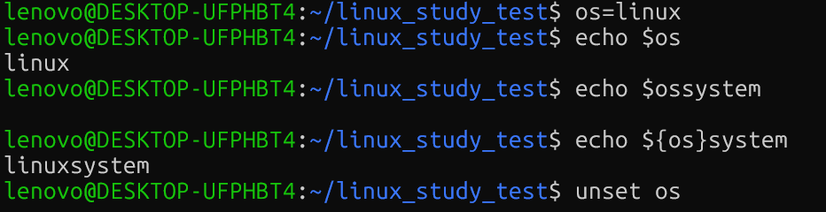

### 引号

将一段内容作为一个整体，并控制Shell是否继续解释其中的特殊字符。

`'...'`：单引号，其中内容基本都按普通字符处理

`"..."`：双引号，大部分按普通字符处理，变量仍然可以展开

e.g. `cd My Flie`无法正常进入，而`cd 'My File'`就可以正常进入了。

在变量的实际使用过程中，建议永远将其**用双引号括起**，否则展开时可能会出现歧义与操作失误。

```
path="/home/chriskim/project data/test project"

rm -rf $path

# 执行上一行命令后，Shell 将会展开变量，变成
rm -rf /home/chriskim/project data/test project
# 此时路径已经被空格裂开了，rm 会尝试删除掉 /home/chriskim/project 和 ./data/test 和 ./project，假如正好有这些文件，那就是非常恐怖的误删失误了

# 如果将变量双引号扩起，就能避免该问题
rm -rf "$path"
# 此时路径仍然作为一个整体来执行
rm -rf "/home/chriskim/project data/test project"
```

### 转义

用`\`转移，表示特殊符号的字面意思

e.g. `touch \*.txt` `mkdir My\ File`


## 1.8 用户与权限

### 用户和用户组

每个用户都有自己的用户名，同时会对应一个数字编号UID，`root`用户的UID固定为0.

Linux还有用户组group，可以把多个用户归为一组，从而方便统一分配权限。用户默认属于同名用户组；用户组也有自己的数字编号，称为GID。

相关命令：

- `whoami`：查询当前用户的用户名
- `id`：查询当前用户完整信息
- `groups`：查询当前用户所属组
- `passwd`：修改用户密码，留空默认修改自己的密码，给定用户名修改其他用户的密码（要权限）
- `su`：switch user
  - 切换用户，需要密码才能切换
  - 核心参数：
    - 位置参数：目标用户名
    - `-` or `-l`：以登录Shell的形式切换

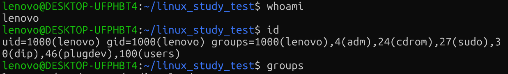

### `root`和`sudo`

`root`是超级用户，拥有系统中的最高权限，UID为0

一般都使用普通用户来操作系统，仅在需要时才临时提权到`root`，此时需要`sudo`命令（需要输入用户密码）。

`sudo`：superuser do

- 核心参数：
  - 位置参数：待执行的命令
  - `-i`：直接进入`root`的Shell
- `exit`：退出返回为普通用户

### 对象的所有者和所属组

每个对象都有一个所有者（power）和一个所属组（group），系统会结合它们和文件的权限设置，判断不同用户能否读取、修改或执行这个文件。

#### 1. 查看所有者/用户组

`ls -l` or `ll`，可以查看对象的详细信息。

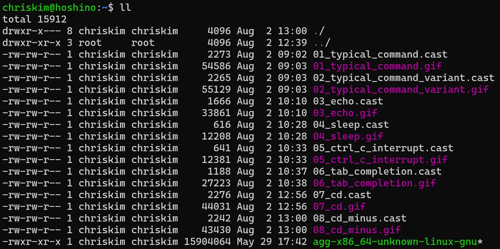

第三列是所有者，第四列是所属组

#### 2. `chown`：change owner

- 用途：修改对象的所有者和用户组

- 核心参数

  - 位置参数1：目标值：`user:group`，用户组可省略
  - 位置参数2：待修改的对象路径
  - `-R`：递归修改目录里的对象

- e.g.

  ```
  chown alice test.txt     # 将 test.txt 的所有者改为 alice，所属组不改
  chown alice:stu test.txt # 将 test.txt 的所有者改为 alice，所属组改为 stu 组
  chown :stu test.txt      # 将 test.txt 的所有者不改，所属组改为 stu 组
  chown alice dir/         # 将 dir/ 的所有者改为 alice，所属组不改
  chown -R alice dir/      # 将 dir/ 以及里面的所有内容的所有者改为 alice，所属组不改
  chown -R alice:stu dir/  # 将 dir/ 以及里面的所有内容的所有者改为 alice，所属组改为 stu 组
  ```

### 对象的权限

上图中，第一列代表了权限的大小。

```
-rwxrwxrwx
││  │  │
││  │  └─ 7~9位：其他用户（others）的权限
││  └──── 4~6位：所属组（group）的权限
│└─────── 1~3位：所有者（user）的权限
└──────── 第0位：文件类型，-为普通文件，d为目录
```

`rwx`的含义：

- `r`：read 读取
- `w`：write 写入
- `x`：execute 执行
- `-`：无权限

e.g.

- `rwxrwxrwx`：所有者、所属组、其他用户都可读、可写、可执行
- `rwxr-xr-x`：所有者可读、可写、可执行，所属组和其他用户可读、可执行
- `rw-r--r--`：所有者可读、可写，所属组和其他用户可读
- `rw-------`：所有者可读、可写，所属组和其他用户没有任何权限

目录和文件的权限含义是不同的。

1. 对于文件：
   - `r`：能否读取该文件内容
   - `w`：能否修改该文件内容
   - `x`：能否运行该文件
2. 对于目录：
   - `r`：是否能列出该目录下的内容
   - `w`：是否能修改目录中的对象列表，例如创建、删除和重命名对象（和对象内容无关）
   - `x`：是否能进入该目录

#### 修改权限：`chmod`

change mode，修改对象的权限

核心参数：

- 位置参数1：权限目标值，较为复杂。
- 位置参数2：待修改的对象路径
- `-R`：递归修改目录内的对象

修改权限目标值分为两种：数字形式和字母形式。

##### 数字形式

适合一次性制定完整的权限。将每一个行为`rwx`的三位字符串看做一个二进制数字，有1无0，故为0-7

| 权限 | 二进制 | 八进制 |
| :--- | :----- | :----- |
| ---  | 000    | 0      |
| --x  | 001    | 1      |
| -w-  | 010    | 2      |
| -wx  | 011    | 3      |
| r--  | 100    | 4      |
| r-x  | 101    | 5      |
| rw-  | 110    | 6      |
| rwx  | 111    | 7      |

那么形如 rwxrwxrwx 的权限格式就能用三个十进制数字来表示了，例如以下对应关系：

- rwxrwxrwx：777
- rwxr-xr-x：755
- rw-r--r--：644
- rw-------：600

e.g.

```bash
chmod 777 dir/    # 将 dir/ 权限设为 rwxrwxrwx
chmod 755 -R dir/ # 将 dir/ 和里面所有内容的权限设为 rwxr-xr-x
chmod 644 a.md    # 将 a.md 权限设为 rw-r--r--
chmod 600 privkey # 将 privkey 权限设为 rw-------
```

##### 字母形式

适合对权限进行增减。

首先通过下面几个字母指定要修改哪一类用户的权限：

- `u`：所有者x
- `g`：所属组
- `o`：其他用户
- `a`：所有用户

然后使用符号代表操作类型：

- `+`：增加权限
- `-`：移除权限
- `=`：直接设置为指定权限

权限仍然使用`rwx`。

e.g.

```bash
chmod u+x main             # 给 main 添加所有者的 x 权限
chmod a-x main             # 给 main 移除任何人的 x 权限
chmod u=rwx,g=rw,o=rw main # 给 main 设置为 rwxrw-rw- 权限
```
常用对象权限：

| **权限组合** | **八进制** | **常用场景**             |
| ------------ | ---------- | ------------------------ |
| `rwxrwxrwx`  | 777        | 大门敞开，非常危险但方便 |
| `rwxr-xr-x`  | 755        | 普通目录或可执行文件     |
| `rwx------`  | 700        | 私密目录                 |
| `rw-r--r--`  | 644        | 普通文件                 |
| `rw-------`  | 600        | 私密文件                 |

## 1.9 软件包管理

Linux中，常见的方式是通过软件包统一管理软件，也可手动安装卸载。Ubuntu使用的软件包格式主要是`.deb`，默认软件包管理命令是`apt`。通过`apt`，我们可以从软件包仓库中搜索、下载、安装、升级和卸载软件。常常使用镜像服务器来下载。

刷新安装包

```bash
sudo apt update
```

搜索软件包

```bash
apt search [name]
```

升级软件包

```bash
sudo apt upgrade
```

列出已安装的软件包

```bash
apt list --installed
```

卸载软件包

```bash
sudo apt remove [name]	# 卸载已安装的软件包
sudo apt purge [name]	# 卸载的同时清除配置
sudo apt autoremove		# 清理所有的无用依赖
```

## 1.10 远程操作

最常见的操作方式是**SSH(Secure Shell)**。通过SSH，可以在自己的电脑上连接到另一台Linux主机。

### `ssh`

- 用途：连接远程主机

- 核心参数：

  - 位置参数：目标主机，格式为`username@location`
  - `-p`：指定SSH窗口，若为默认端口22可省略

- e.g.

  ```bash
  ssh chriskim@192.168.6.122
  ```

退出时用`exit`，此时在Shell运行的普通任务都会被终止。

### `scp`：secure copy

- 用途：通过SSH在本地与远程主机之间传输文件

- 核心参数：

  - 位置参数1：原始对象路径
  - 位置参数2：目标对象路径
  - `-r`：递归传输目录
  - `-p`：指定SSH窗口，若为默认22可省略

- 与`cp`很类似，区别在于，`scp`可以通过`username@location:path`来指定远端路径。

- e.g.

  ```bash
  scp chriskim@192.168.6.122:~/test.txt .             # 把远程计算机的 test.txt 文件下载到本地
  scp -r chriskim@192.168.6.122:/data/my-project D:\  # 把远程计算机的 /data/my-project 目录下载到本地 D 盘
  scp D:\archive.zip root@192.168.1.100:/data         # 把本地 D 盘的 archive.zip 上传到远程计算机 /data 目录
  scp -r D:\projects root@192.168.1.100:~             # 把本地 D 盘的 projects 目录上传到远程计算机用户家目录
  ```


## 1.11 目录结构

Linux的大致目录结构：

```txt
/
├── bin      常用命令
├── boot     启动相关文件
├── dev      设备文件
├── etc      系统配置
├── home     普通用户的家目录
├── lib      系统库文件
├── media    U盘、光盘等可移动设备挂载点
├── mnt      临时挂载目录
├── opt      第三方软件
├── proc     进程和内核信息
├── root     root 用户的家目录
├── run      系统运行时数据
├── sbin     系统管理命令
├── srv      服务提供的数据
├── sys      硬件和内核信息
├── tmp      临时文件
├── usr      大量程序、库和共享文件
└── var      日志、缓存等经常变化的数据
```

- 挂载磁盘

硬盘、U盘通常可以在`/dev`下看到；磁盘需要挂载在某个目录后才能访问，如`/mnt`（手动挂载）、`/media`（自动挂载）

- 安装用户应用
  - 个人文件一般存放在`/home/lenovo`
  - 手动安装第三方软件经常放在`/opt`（存放相对独立的第三方软件）、 `/usr/local`（用户或管理员自行安装的软件）

- 系统安装的软件

  大量软件位于`/usr`，较为常见的有：

  ```bash
  /usr/bin 		# 可执行程序
  /usr/lib		# 程序库
  /usr/share		# 文档、图标等共享资源
  ```

  `/bin`和`/sbin`主要用于存放系统命令。现代很多发行版中已链接到`/usr`下。

- 修改系统配置

放在`/etc`中，这是某个软件/系统的配置

- 临时存放文件

放在`/tmp`中，可能会被系统自动清理，因此不适合长期保存重要文件

- 系统和硬件信息

```bash
/proc    进程和内核运行信息
/sys     设备和内核相关信息
/dev     各种设备文件
```

由系统动态提供。

- 系统启动文件

位于`/boot`，初始化文件和引导程序相关文件通常在这里。不要随意修改这些文件。